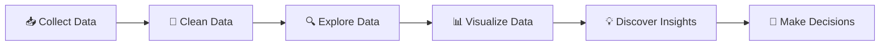

<div align="center">

# 📊 Data Analysis Portfolio

### Turning Raw Data into Meaningful Insights 🚀

*A collection of hands-on data analysis projects using real-world datasets, Python, and powerful data visualization libraries.*

<br>


</div>

---

## 👋 Welcome!

Welcome to my **Data Analysis Repository**! 🎉

This repository contains my hands-on journey of learning and practicing **Data Analysis**. Here, I work with real-world datasets to clean data, explore patterns, visualize relationships, and discover meaningful insights.

> 💡 **My goal:** Learn how to transform raw data into information that can help people make better decisions.

---

## 🧠 What You'll Find Here

📂 **Real-world datasets**  
📊 **Exploratory Data Analysis (EDA)**  
🧹 **Data Cleaning & Preprocessing**  
📈 **Data Visualization**  
🔍 **Finding Patterns & Relationships**  
📓 **Jupyter Notebook Analysis Projects**

---

## 🗂️ Datasets & Projects

| 📁 Dataset | 🔎 What I'm Exploring |
|---|---|
| 🚢 **Titanic Dataset** | Passenger survival patterns and feature relationships |
| 🛒 **Sample Superstore** | Sales, profit, discount, and business insights |
| 🏨 **Hotel Bookings** | Booking behavior, cancellations, and customer patterns |
| 🛍️ **Online Retail** | Customer purchases, products, and revenue analysis |

> 🚀 More datasets and projects will be added as I continue my data analysis journey!

---

## 🛠️ Technologies & Libraries

This repository uses the following tools:

```text
🐍 Python
🐼 Pandas
🔢 NumPy
📊 Matplotlib
🎨 Seaborn
📓 Jupyter Notebook
```

---

## 🔄 My Data Analysis Workflow



---

## 📈 What I Practice

<details>
<summary><b>🧹 Data Cleaning</b></summary>

<br>

- Handling missing values
- Removing duplicates
- Correcting data types
- Preparing datasets for analysis

</details>

<details>
<summary><b>🔍 Exploratory Data Analysis</b></summary>

<br>

- Understanding dataset structure
- Calculating summary statistics
- Finding patterns and trends
- Identifying relationships between variables

</details>

<details>
<summary><b>📊 Data Visualization</b></summary>

<br>

- Histograms
- Bar Charts
- Line Charts
- Box Plots
- Heatmaps
- Scatter Plots
- Correlation Analysis

</details>

---

## 🎯 Learning Journey

```text
Data Collection  📥
       ↓
Data Cleaning    🧹
       ↓
Data Exploration 🔍
       ↓
Data Visualization 📊
       ↓
Finding Insights 💡
       ↓
Continuous Learning 🚀
```

---

## 🚀 Getting Started

If you'd like to explore the notebooks locally:

### 1️⃣ Clone the repository

```bash
git clone https://github.com/YOUR-USERNAME/Data_Analysis.git
```

### 2️⃣ Install the required libraries

```bash
pip install pandas numpy matplotlib seaborn jupyter
```

### 3️⃣ Open Jupyter Notebook

```bash
jupyter notebook
```

Then open any notebook and start exploring! 📊

---

## 📌 Repository Structure

```text
📦 Data_Analysis
 ┣ 📂 Datasets
 ┃ ┣ 🛒 SampleSuperstore.csv
 ┃ ┣ 🚢 Titanic-Dataset.csv
 ┃ ┣ 🏨 hotel_bookings.csv
 ┃ ┗ 🛍️ Online Retail.xlsx
 │
 ┣ 📓 test_1.ipynb
 ┣ 📓 test_2.ipynb
 ┣ 📓 test_3.ipynb
 ┣ 📓 test_4.ipynb
 ┣ 📓 test_5.ipynb
 ┣ 📓 test_6.ipynb
 ┗ 📄 README.md
```

---

## 🌟 Future Goals

- [x] Learn Python for Data Analysis
- [x] Practice with real-world datasets
- [x] Perform Exploratory Data Analysis
- [ ] Build more advanced analysis projects
- [ ] Create interactive dashboards
- [ ] Learn Machine Learning
- [ ] Build end-to-end data projects

---

<div align="center">

## 💬 Let's Connect!

⭐ **If you find this repository interesting, consider giving it a star!**

### 🚀 Learning • Exploring • Analyzing • Growing

**Thanks for visiting my Data Analysis journey! 📊**

</div>
